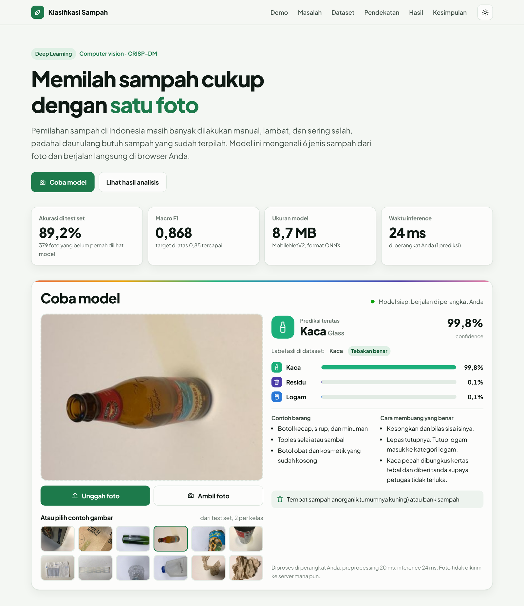
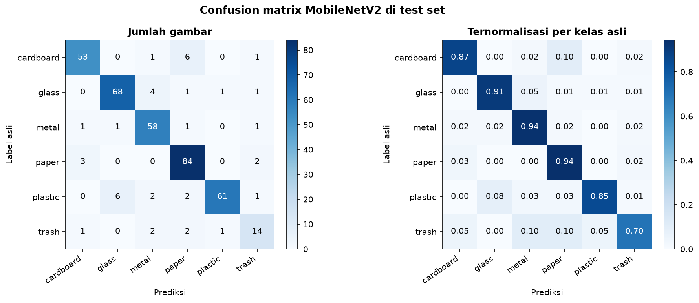
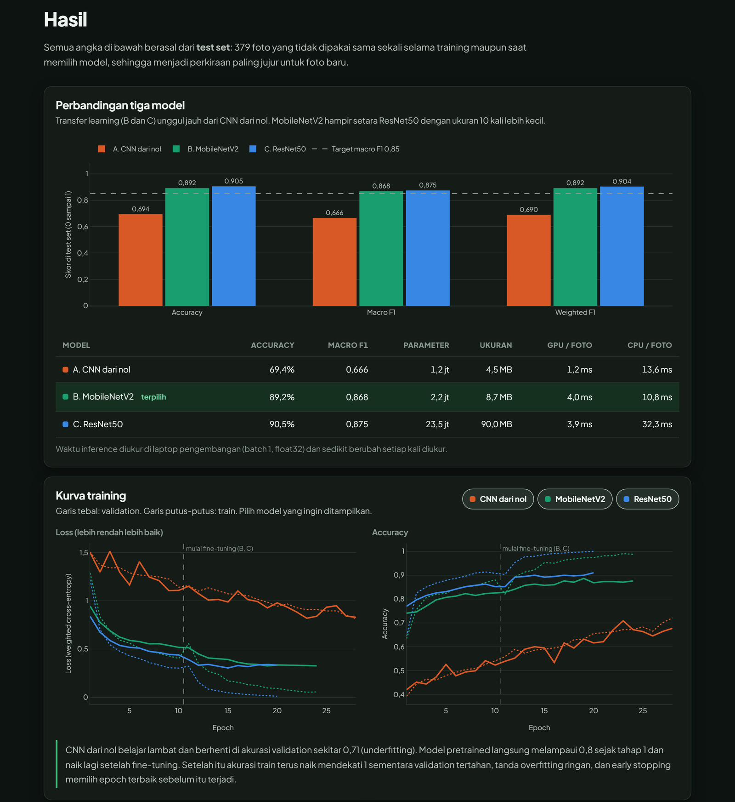

# Klasifikasi Sampah dengan CNN dan Transfer Learning


Model deep learning yang mengenali **6 jenis sampah** (kardus, kaca, logam, kertas, plastik, residu) dari satu foto, lengkap dengan website demo yang menjalankan model **langsung di browser**, tanpa server.

**Demo live: [frgwnabim.github.io/garbage-classification](https://frgwnabim.github.io/garbage-classification/)**



| Hasil utama (test set, 379 foto) | |
|---|---|
| Model terpilih | MobileNetV2 (transfer learning) |
| Accuracy | **89,2%** |
| Macro F1 | **0,868** (target > 0,85) |
| Ukuran model | **8,7 MB** (ONNX float32) |
| Prediksi di browser | identik dengan PyTorch untuk 12 dari 12 contoh (sampai 4 desimal) |

---

## Daftar isi
- [Masalah](#masalah)
- [Dataset](#dataset)
- [Metodologi](#metodologi)
- [Hasil](#hasil)
- [Temuan utama](#temuan-utama)
- [Keterbatasan](#keterbatasan)
- [Hardware dan waktu training](#hardware-dan-waktu-training)
- [Cara menjalankan dari nol](#cara-menjalankan-dari-nol)
- [Struktur repo](#struktur-repo)

## Masalah

Pemilahan sampah di Indonesia masih banyak dilakukan manual di rumah tangga, TPS, dan bank sampah: lambat, melelahkan, dan sering salah. Padahal industri daur ulang membutuhkan sampah yang sudah terpilah per jenis. Proyek ini membangun model klasifikasi foto sampah sebagai dasar sistem pemilahan otomatis atau aplikasi edukasi pemilahan sampah.

Pertanyaan yang dijawab:
1. Seberapa akurat model dengan data terbatas (sekitar 2.500 foto)?
2. Seberapa besar keuntungan transfer learning dibanding CNN dari nol?
3. Kelas mana yang paling sering tertukar, dan kenapa?
4. Model mana yang paling cocok untuk aplikasi nyata (akurasi vs ukuran vs kecepatan)?

**Kriteria sukses:** macro F1 di test set > 0,85, tidak ada kelas dengan F1 < 0,70, dan model < 30 MB. Macro F1 dipakai (bukan hanya akurasi) karena data tidak seimbang: setiap kelas dihitung sama penting, sehingga kelas kecil seperti residu tidak bisa diabaikan.

## Dataset

**Sumber:** [Garbage classification di Kaggle](https://www.kaggle.com/datasets/asdasdasasdas/garbage-classification), turunan dari dataset [TrashNet](https://github.com/garythung/trashnet) (Gary Thung dan Mindy Yang, 2016).

| | |
|---|---|
| Jumlah foto | 2.527 (2.521 setelah 6 duplikat berlabel ganda dibuang) |
| Kelas | cardboard 403, glass 501, metal 410, paper 594, plastic 482, trash 137 |
| Format | JPEG, RGB, semua 512 x 384 piksel |
| Rasio imbalance | 4,3 : 1 (paper vs trash) |
| Split | stratified 70/15/15 (train 1.764, val 378, test 379), seed 42, disimpan di `outputs/splits.json` |

**Cara download:**
1. Unduh zip dari halaman Kaggle di atas (tombol *Download*, perlu login), atau lewat [Kaggle CLI](https://github.com/Kaggle/kaggle-api):
   ```bash
   kaggle datasets download -d asdasdasasdas/garbage-classification -p dataset_raw --unzip
   ```
2. Rapikan ke struktur yang diharapkan dengan script berikut (script mencari folder kelas di dalam folder hasil ekstrak, yang aslinya bertingkat):
   ```bash
   python scripts/prepare_data.py dataset_raw
   ```

**Struktur folder yang diharapkan** (folder `data/` tidak di-commit):
```
data/
├── cardboard/   cardboard1.jpg ... (403 file)
├── glass/       glass1.jpg ...     (501 file)
├── metal/       ...                (410 file)
├── paper/       ...                (594 file)
├── plastic/     ...                (482 file)
└── trash/       ...                (137 file)
```

## Metodologi

Seluruh analisis ada di [`notebook.ipynb`](notebook.ipynb), mengikuti **CRISP-DM**:

| Tahap | Isi |
|---|---|
| 1. Business Understanding | Konteks, 4 pertanyaan, kriteria sukses |
| 2. Data Understanding | Distribusi kelas, contoh foto, resolusi, cek bias background lewat warna rata-rata |
| 3. Data Preparation | Buang duplikat berlabel ganda, split stratified, augmentasi (RandomResizedCrop, flip, rotasi kecil, ColorJitter), class weights |
| 4. Modeling | Tiga eksperimen dengan pengaturan training yang sama |
| 5. Evaluation | Test set dipakai sekali: perbandingan model, per kelas, confusion matrix, error analysis, Grad-CAM, uji ketahanan |
| 6. Deployment | Export ONNX, verifikasi PyTorch vs ONNX, website statis dengan onnxruntime-web |

**Tiga model yang dibandingkan:**
- **A. CNN dari nol:** 4 blok konvolusi, 1,2 juta parameter (baseline).
- **B. MobileNetV2 pretrained ImageNet:** dua tahap, feature extraction (hanya classifier, lr 1e-3) lalu fine-tuning 5 blok terakhir (lr 1e-4).
- **C. ResNet50 pretrained ImageNet:** strategi dua tahap yang sama, fine-tuning `layer4`.

Pengaturan training yang sama untuk semua model: `CrossEntropyLoss` dengan class weights, AdamW (weight decay 1e-4), `ReduceLROnPlateau`, early stopping berdasarkan val loss (patience 5), checkpoint terbaik, dan mixed precision (`torch.amp`). Training deterministik (seed 42, cuDNN deterministic), jadi hasilnya bisa diulang persis.

Pemilihan model memakai **validation set** dengan aturan eksplisit: macro F1 tertinggi, tetapi pilih model yang lebih kecil jika selisihnya ≤ 0,02, karena model dijalankan di browser.

## Hasil

**Perbandingan di test set** (379 foto yang tidak dipakai sama sekali saat training maupun memilih model):

| Model | Accuracy | Macro F1 | Weighted F1 | Parameter | Ukuran | CPU / foto* |
|---|---:|---:|---:|---:|---:|---:|
| A. CNN dari nol | 0,694 | 0,666 | 0,690 | 1,2 jt | 4,5 MB | ±15 ms |
| **B. MobileNetV2** (terpilih) | **0,892** | **0,868** | **0,892** | 2,2 jt | **8,7 MB** | **±10 ms** |
| C. ResNet50 | 0,905 | 0,875 | 0,904 | 23,5 jt | 90,0 MB | ±35 ms |

\* Batch 1, float32, di CPU laptop pengembangan. Angkanya sedikit berubah setiap kali diukur.

MobileNetV2 dipilih berdasarkan validation (macro F1 0,881 vs 0,879 untuk ResNet50). Di test set ResNet50 unggul tipis (sekitar 5 foto), tetapi keputusan tidak diubah setelah melihat test set, dan selisihnya tetap di dalam toleransi 0,02.

**Confusion matrix MobileNetV2 (test set):**



| Kriteria sukses | Target | Hasil | Status |
|---|---|---|---|
| Macro F1 di test set | > 0,85 | 0,868 | Tercapai |
| F1 per kelas terendah | ≥ 0,70 | 0,700 (trash) | Tercapai, tepat di batas |
| Ukuran model | < 30 MB | 8,7 MB | Tercapai |
| Waktu inference | < 1 detik | belasan ms | Tercapai |



## Temuan utama

- **Transfer learning memberi lompatan besar.** Macro F1 naik sekitar 20 poin (0,666 menjadi 0,868) dan jumlah kesalahan turun hampir 3 kali (31% menjadi 11%), dengan waktu training lebih singkat. CNN dari nol juga underfitting dan runtuh di foto gelap (akurasi turun 51 poin).
- **Kelas yang paling sering tertukar:** kardus dan kertas (kardus tipis dan kotak kemasan bercetak mirip kertas tebal), serta plastik yang ditebak kaca (sama-sama transparan). Residu paling lemah (F1 0,70) karena isinya campuran material dan datanya paling sedikit.
- **Model melihat objek, bukan background.** Grad-CAM menunjukkan perhatian model ada di objek sampah. Secara kuantitatif, perhatian di tepi gambar (area background) selalu di bawah rata-rata untuk semua kelas.
- **Kesalahan umumnya terjadi saat model ragu.** Median confidence prediksi salah 0,71 vs 0,99 untuk prediksi benar, sehingga demo menampilkan peringatan jika confidence < 50%.
- **Uji ketahanan:** gelap dan rotasi hampir tidak berpengaruh, tetapi blur berat menurunkan akurasi MobileNetV2 26,6 poin (ResNet50 12,1 poin).
- **MobileNetV2 paling cocok untuk aplikasi nyata:** performa setara ResNet50 dengan ukuran 10 kali lebih kecil dan inference di CPU beberapa kali lebih cepat.
- **Browser = notebook.** Preprocessing di website meniru `Resize(256)` + `CenterCrop(224)` torchvision dengan algoritma resample bilinear milik Pillow secara bit per bit, sehingga prediksi di browser identik dengan PyTorch.

## Keterbatasan

- **Dataset kecil** (2.521 foto). Kelas trash hanya 137 foto (20 di test set), sehingga angka per kelas punya ketidakpastian besar.
- **Foto studio dengan latar polos dan pencahayaan dalam ruangan.** Akurasi di tempat sampah atau TPS sungguhan kemungkinan lebih rendah.
- **Hanya satu objek per foto**, belum bisa menangani tumpukan sampah campuran.
- **Belum diuji di foto nyata**, apalagi foto dari Indonesia (kemasan lokal, sampah kotor atau basah).
- **Rentan terhadap foto buram**, dan beberapa label di dataset diragukan.

Ide pengembangan: data foto nyata Indonesia, object detection (misalnya YOLO) untuk banyak sampah sekaligus, kelas organik dan B3, serta augmentasi blur, noise, dan penggantian background.

## Hardware dan waktu training

| | |
|---|---|
| GPU | NVIDIA GeForce RTX 4060, 8 GB VRAM |
| OS | Windows 11 |
| Software | Python 3.13, PyTorch 2.14 + CUDA 13.2, mixed precision float16 |
| Batch size | 32, gambar 224 x 224 |

| Model | Epoch (dengan early stopping) | Waktu training | VRAM puncak |
|---|---:|---:|---:|
| A. CNN dari nol | 28 | 2 sampai 3 menit | 1,0 GB |
| B. MobileNetV2 | 10 + 14 | 1 sampai 1,5 menit | 0,23 GB |
| C. ResNet50 | 10 + 10 | 1 sampai 1,5 menit | 0,49 GB |

Menjalankan seluruh notebook dari awal (training, evaluasi, Grad-CAM, export ONNX) sekitar 8 menit. Waktu per epoch sedikit berubah antar run, tetapi hasil training identik karena deterministik. DataLoader memakai 4 worker persisten (otomatis kembali ke `num_workers=0` jika gagal di Windows).

## Cara menjalankan dari nol

Perintah di bawah memakai Windows (PowerShell atau Git Bash). Di Linux/macOS, ganti `.venv\Scripts\` dengan `.venv/bin/`.

**1. Clone repo**
```bash
git clone https://github.com/frgwnabim/garbage-classification.git
cd garbage-classification
```

**2. Buat virtual environment** (Python 3.10 sampai 3.13)
```bash
python -m venv .venv
.venv\Scripts\python -m pip install --upgrade pip
```

**3. Install PyTorch versi CUDA dan library lain.** `requirements.txt` sudah menunjuk ke index resmi PyTorch (`cu132`), jadi yang terpasang adalah versi CUDA, bukan versi CPU.
```bash
.venv\Scripts\pip install -r requirements.txt
```
Kalau driver GPU Anda lebih lama (cek dengan `nvidia-smi`), pilih wheel CUDA yang sesuai di [pytorch.org/get-started/locally](https://pytorch.org/get-started/locally/), misalnya `cu126`, lalu sesuaikan baris `--extra-index-url` dan versi `torch`/`torchvision` di `requirements.txt`. Cek GPU terdeteksi:
```bash
.venv\Scripts\python -c "import torch; print(torch.cuda.is_available(), torch.cuda.get_device_name(0))"
```

**4. Download dan rapikan dataset** (lihat bagian [Dataset](#dataset))
```bash
kaggle datasets download -d asdasdasasdas/garbage-classification -p dataset_raw --unzip
.venv\Scripts\python scripts/prepare_data.py dataset_raw
```

**5. Daftarkan kernel dan jalankan notebook**
```bash
.venv\Scripts\python -m ipykernel install --user --name garbage-classification --display-name "Python (garbage-classification)"
.venv\Scripts\jupyter lab notebook.ipynb
```
Pilih kernel *Python (garbage-classification)*, lalu *Restart Kernel and Run All Cells*. Atau jalankan tanpa membuka Jupyter:
```bash
.venv\Scripts\jupyter nbconvert --to notebook --execute --inplace notebook.ipynb
```
Notebook menghasilkan checkpoint di `checkpoints/`, model ONNX di `models/`, hasil analisis di `outputs/`, dan menyalin semuanya ke `site/`.

**6. Jalankan website lokal**
```bash
.venv\Scripts\python scripts/build_site.py
.venv\Scripts\python -m http.server 8000 --directory site
```
Buka [http://localhost:8000](http://localhost:8000). Website harus dibuka lewat server (bukan klik ganda `index.html`) karena memakai ES module dan `fetch`. Untuk mengecek prediksi browser sama dengan notebook, buka console browser lalu jalankan `await garbageDemo.selfTest()`.

**Deploy:** setiap push ke `main` yang mengubah `site/` otomatis di-deploy ke GitHub Pages oleh workflow [`.github/workflows/pages.yml`](.github/workflows/pages.yml).

## Struktur repo

```
garbage-classification/
├── notebook.ipynb              # analisis lengkap (CRISP-DM), dijalankan dari awal sampai akhir
├── src/
│   ├── data.py                 # dataset, transform, split, class weights, dataloader
│   ├── models.py               # CNN dari nol, MobileNetV2, ResNet50, freeze/unfreeze
│   ├── train.py                # loop training (AMP, scheduler, early stopping, checkpoint)
│   ├── evaluate.py             # metrik, confusion matrix, Grad-CAM, uji ketahanan
│   └── deploy.py               # export ONNX, verifikasi, quantization, preprocessing.json
├── scripts/
│   ├── prepare_data.py         # rapikan dataset Kaggle ke data/<kelas>/
│   └── build_site.py           # salin model dan hasil analisis ke site/
├── models/                     # garbage_classifier.onnx, labels.json, preprocessing.json
├── outputs/                    # hasil analisis (JSON dan PNG), splits.json
├── site/                       # website demo statis (GitHub Pages)
│   ├── index.html
│   ├── assets/                 # css, js (demo, preprocessing, chart), gambar, contoh foto
│   ├── models/                 # salinan model untuk browser
│   └── data/                   # salinan JSON hasil analisis untuk chart
├── docs/                       # screenshot untuk README
├── .github/workflows/pages.yml # deploy site/ ke GitHub Pages
├── requirements.txt
├── data/                       # dataset (tidak di-commit)
└── checkpoints/                # checkpoint training (tidak di-commit)
```

## Kredit

Dataset: Gary Thung dan Mindy Yang, *Classification of Trash for Recyclability Status* (TrashNet, 2016), versi Kaggle oleh pengguna asdasdasasdas. Proyek portofolio oleh Ebim, [frgwnabim.site](https://frgwnabim.site).
